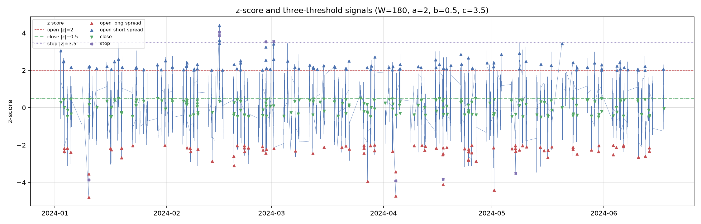
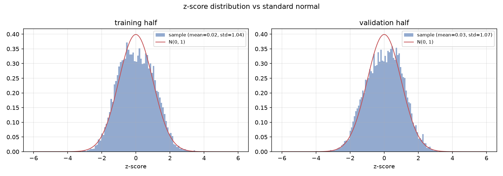
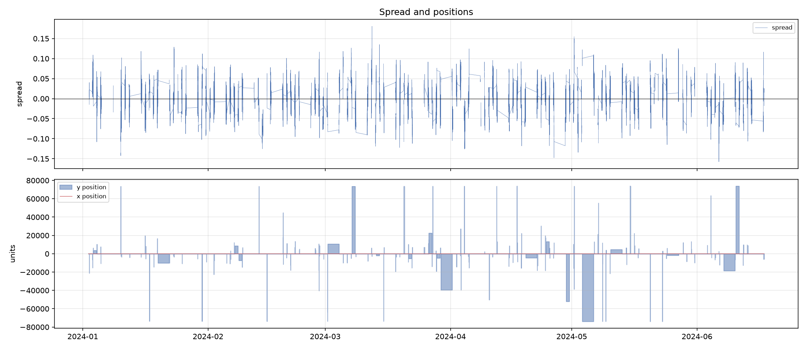
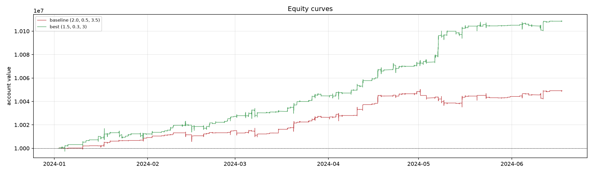

# OU Pairs Trading · 国债 ETF × 国债期货

基于 Ornstein–Uhlenbeck 过程的配对交易研究代码：滚动对冲比率、OU 参数估计、三阈值均值回归策略、训练/验证校准，以及 backtrader 回测。

仓库不附带任何行情数据，开箱即用的是合成数据 demo。这套代码最初用于国债 ETF 与国债期货的 1 分钟配对研究，方法本身适用于任何可检验协整关系的两条价格序列。

面向非技术读者的项目简介见 [PROJECT.md](PROJECT.md)。

**English**: A reproducible research repo for OU mean-reversion pairs trading, with rolling OLS hedge ratios, AR(1) parameter estimation, three-threshold signals, walk-forward-style calibration, and a backtrader implementation. No market data is included; a synthetic cointegrated pair is generated for the demo.

---

## 1. 方法

### 1.1 价差与滚动对冲比率

对两条对齐的价格序列 `y`（ETF）和 `x`（国债期货）：

```text
y_t = α + β · x_t + Z_t
```

在每个 bar `t`，用截至 `t-1` 的 `W` 根 bar 做 OLS，得到 `α_t, β_t`，再构造当期价差：

```text
Z_t = y_t − α_t − β_t · x_t
```

窗口结束时点在 `t-1`，参数应用到 `t`，不使用未来信息。

### 1.2 OU 参数估计

连续时间过程：

```text
dZ_t = θ(μ − Z_t) dt + σ dW_t
```

用精确离散化 `Z_t = c + φ Z_{t-1} + ε_t`，其中 `φ = exp(−θΔt)`，回归得到：

```text
μ        = c / (1 − φ)
θ        = −ln(φ) / Δt
σ_eq     = s_ε / sqrt(1 − φ²)
half-life = ln 2 / θ
```

滚动窗口同样只用 `[t−W, t−1]` 的历史，得到 `μ_t, σ_eq,t`，再计算 z-score：

```text
S_t = (Z_t − μ_t) / σ_eq,t
```

### 1.3 信号与仓位

三阈值框架，要求 `0 < b < a < c`：

| 状态 | 条件 | 动作 |
| --- | --- | --- |
| 空仓 | `S < −a` | 做多价差：买 ETF，卖期货 |
| 空仓 | `S > +a` | 做空价差：卖 ETF，买期货 |
| 持仓 | `|S| < b` | 平仓 |
| 持仓 | `|S| > c` | 止损平仓 |

仓位大小与偏离程度成比例：

```text
frac = clip((|S| − a) / (c − a), 0, 1)
期货手数 = round(max_x_units · frac)
ETF 份数 = round(期货手数 / β)
```

ETF 端再受 90% 可用现金约束。默认最多 8 手期货、最少 100 份 ETF、初始资金 1,000 万。

### 1.4 撮合口径

- backtrader 在 bar `t` 收盘后计算信号，市价单在 `t+1` 开盘成交；
- 校准用的快速引擎按 `t` 信号、`t+1` 收益结算，只用于参数排序，最终数字以 backtrader 为准；
- demo 佣金、滑点、冲击成本均为 0，仅用于验证代码与流程。

---

## 2. 快速开始

```bash
git clone <your-repo-url> ou-pairs-trading
cd ou-pairs-trading

python -m venv .venv
# Windows
.venv\Scripts\activate
# macOS / Linux
# source .venv/bin/activate

pip install -r requirements.txt
```

生成合成数据并跑完整流程：

```bash
python scripts/make_synthetic_data.py
python scripts/run_pipeline.py
```

参数校准 + 训练/验证对比：

```bash
python scripts/run_calibration.py
```

跑测试：

```bash
pip install -r requirements-dev.txt
pytest -q
```

输出位置：

- `output/features.csv`：滚动 `α/β`、价差、OU 参数、z-score
- `output/backtest_log_*.csv`、`output/backtest_trades_*.csv`
- `output/calibration_grid.csv`、`output/backtest_summary.csv`
- `docs/figures/*.png`

`data/` 与 `output/` 已在 `.gitignore` 中，不会误提交行情数据或回测明细。

---

## 3. 数据格式

如果使用自己的数据，准备一个按时间对齐的 1 分钟 CSV，至少包含：

| 列名 | 含义 |
| --- | --- |
| `datetime` | bar 时间戳，可解析为日期时间 |
| `y_open`, `y_high`, `y_low`, `y_close` | ETF 端 OHLC（每份价格） |
| `x_open`, `x_high`, `x_low`, `x_close` | 期货端 OHLC（原始报价） |
| `y_volume`, `x_volume` | 可选，当前策略不使用 |

`x` 按原始报价传入，通过 `--x-multiplier` 换算成每张合约价格。国债期货按每百元面值报价时取 `10000`：

```bash
python scripts/run_pipeline.py \
  --data path/to/aligned.csv \
  --x-multiplier 10000 \
  --window 180 --a 2.0 --b 0.5 --c 3.5
```

两腿应当按时间戳内连接（inner join），保证同一 bar 同时存在；连续合约的换月跳空、ETF 分红复权等预处理应在传入前完成，本仓库不包含具体品种的复权规则。

---

## 4. Demo 结果

合成数据：120 个交易日、每日 240 根 1 分钟 bar，共 28,800 根；训练/验证按时间 50/50 切分；初始资金 1,000 万；零费率。

### 4.1 价差诊断（训练半段）

| 指标 | 数值 |
| --- | --- |
| ADF 统计量 | −12.77 |
| ADF p-value | 7.85e−24 |
| 静态 OU 半衰期 | 18.8 bars |
| 滚动半衰期中位数 | 11.3 bars |

### 4.2 样本内网格（27 组，按夏普排序节选）

| a | b | c | 训练期收益 | 训练期夏普 | 最大回撤 |
| --- | --- | --- | --- | --- | --- |
| 1.5 | 0.3 | 3.0 | 0.47% | 9.20 | −0.06% |
| 1.5 | 0.5 | 3.0 | 0.46% | 8.97 | −0.06% |
| 1.5 | 0.8 | 3.0 | 0.46% | 8.97 | −0.06% |
| 2.0 | 0.8 | 3.0 | 0.18% | 6.06 | −0.05% |

规律与预期一致：`a` 越小，信号越多、夏普越高；`c` 收紧到 3.0 对尾部保护更好。注意这是快速引擎的排序结果，夏普数值不能与 backtrader 直接比较。

### 4.3 backtrader 全样本

| 参数 | 期末净值 | 累计收益 | 年化收益 | 年化夏普 | 最大回撤 | 开仓次数 |
| --- | --- | --- | --- | --- | --- | --- |
| baseline (2.0, 0.5, 3.5) | 10,049,120 | 0.49% | 0.99% | 2.93 | −0.15% | 187 |
| best (1.5, 0.3, 3.0) | 10,108,555 | 1.09% | 2.20% | 4.49 | −0.09% | 362 |

验证半段（快速引擎，仅看相对排序）：训练前三组参数的收益为 0.65%–0.69%，夏普 10.3–11.0；`b` 在 0.3–0.8 之间构成一个较平的高分区，最优解并不唯一。

### 4.4 图









---

## 5. 代码结构

```text
ou-pairs-trading/
├── src/
│   ├── ou.py           # OLS、AR(1) OU、滚动特征、ADF
│   ├── synthetic.py    # 合成协整价格序列
│   ├── data.py         # CSV 读取、校验、训练/验证切分
│   ├── strategy.py     # backtrader 策略与回测入口
│   ├── calibration.py  # 快速引擎与网格搜索
│   ├── metrics.py      # 收益、夏普、回撤
│   └── plots.py        # 四类图
├── scripts/
│   ├── make_synthetic_data.py
│   ├── run_pipeline.py
│   └── run_calibration.py
├── tests/
│   ├── test_ou.py
│   └── test_pipeline.py
├── docs/figures/
├── requirements.txt
└── README.md
```

---

## 6. 实现要点

- **无未来函数**：滚动参数窗口止于 `t−1`；backtrader 市价单在下一根 bar 成交；`tests/test_ou.py` 用“改动 `y_t` 不影响 `beta_t`、但会影响 `beta_{t+1}`”做了显式断言。
- **数值稳定**：OLS 使用中心化公式，避免期货名义价格量级带来的相消误差；滚动 OLS 用累计和加速。
- **参数可复现**：合成数据固定随机种子；所有脚本支持 CLI 覆盖窗口、阈值、乘数、资金等参数。
- **校准与验证分离**：只在训练半段排序参数，再在验证半段检查外推；最终报告数字统一用 backtrader 复算。

---

## 7. 局限

1. 合成数据是已知 OU 过程生成的，回测结果按构造偏乐观；它验证的是代码与流程，不是真实市场的盈利能力。
2. 未计佣金、滑点、盘口冲击和部分成交。1 分钟频率、数百次开仓对费率非常敏感，实盘需要按真实费率复测。
3. 仅做一次性 50/50 切分，没有 walk-forward 或多折验证；参数稳健性还需要滚动窗口、不同品种、不同年份的补充测试。
4. 快速引擎在持仓期间按 `|S|` 逐 bar 调整仓位，且以初始资金计算约束；backtrader 只在开仓时定仓。两者夏普不可直接比较。
5. 未建模保证金、卖空约束、期货换月与 ETF 分红复权；输入序列应事先处理成连续、可比的价格。
6. 滚动 `β` 会漂移，ADF 只是入场闸门，不能保证样本外价差仍然平稳。

---

## 8. License

MIT
